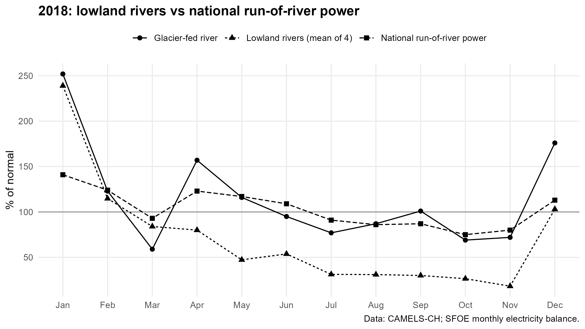

# Dry years in Switzerland: river flow and run-of-river hydropower

I wanted to find out how the dry years 2003 and 2018 affected Swiss rivers, and whether run-of-river hydropower dropped in the same way.

## What I found

- 2003 and 2018 were dry in different ways. In 2003 the lowland rivers dropped to 23–28 % of normal in summer. In 2018 the dry period lasted longer and was worst in autumn, with the Broye at 11 % of normal in October.
- The lowland rivers were hit hardest. In 2018 four lowland and pre-Alpine rivers averaged 18–31 % of normal from July to November.
- The glacier-fed Weisse Lütschine hardly dropped, because the heat made the glacier melt more.
- National run-of-river production dropped at the same time as the rivers, but only to about 75 % of normal at its lowest.

The full write-up is in [`report/Swiss_dry_years_report.pdf`](report/Swiss_dry_years_report.pdf).

## Data

- CAMELS-CH (Höge et al., 2023): daily discharge for 331 catchments, 1981–2020. I used six Swiss catchments with complete records and no hydropower plants listed.
- Swiss Federal Office of Energy: monthly electricity balance (ogd35), run-of-river production from 2000.

The raw data is not in this repository. The script downloads the electricity data, and CAMELS-CH is available on [Zenodo](https://doi.org/10.5281/zenodo.15025258).

## Method

I averaged daily discharge to monthly values and compared each month of 2003 and 2018 with the 1981–2020 average for that month, leaving out 2003 and 2018. I did the same for run-of-river production, using 2000–2020 as the baseline.

## Tools

R (tidyverse, janitor, here, ggplot2)

## Author

Anas Meer Ahmed, BSc Energy and Environmental Systems Engineering, HSLU
